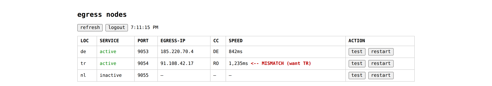

# egress-node-manager

[](#quick-start)
[](#commands)
[-yellow.svg)](#web-panel)
[](#how-it-works)
[](#license)

Small bash script that spins up local Tor SOCKS5 proxies, one per exit
country. I use it to feed country-based outbounds into Xray.

```text
                             tor-egress-tr  127.0.0.1:9053 -> Turkey exit
Xray / 3x-ui routing rules -> tor-egress-de  127.0.0.1:9054 -> Germany exit
                             tor-egress-nl  127.0.0.1:9055 -> Netherlands exit
```

It only creates local proxies on `127.0.0.1:<port>`. It does not touch
Xray, 3x-ui, firewall rules or anything else.

<p align="center"></p>
<p align="center"></p>

## quick start

Needs root and a debian/ubuntu box.

```bash
chmod +x egress-node-manager.sh
sudo ./egress-node-manager.sh menu
```

Or install it somewhere on PATH:

```bash
sudo cp egress-node-manager.sh /usr/local/bin/egress-node-manager
sudo chmod +x /usr/local/bin/egress-node-manager
egress-node-manager menu
```

## commands

| command           | alias     | what it does                              |
| ----------------- | --------- | ----------------------------------------- |
| `menu`            |           | interactive menu                          |
| `add <cc> [port]` | `install` | add a country node, port auto-picks       |
| `list`            |           | show installed nodes                      |
| `json <cc>`       |           | print xray outbound snippet               |
| `logs <cc>`       |           | journal + tor log for a node              |
| `test <cc>`       |           | run health check again                    |
| `restart <cc>`    |           | restart for a fresh circuit               |
| `delete <cc>`     | `remove`  | remove a node and its files               |
| `upgrade`         | `fix`     | rewrite torrc files with current settings |
| `clean-db`        |           | drop stale meta files                     |

```bash
egress-node-manager add tr 9053
egress-node-manager add de
egress-node-manager test tr
egress-node-manager json tr
```

Omit the port and it takes the first free one starting at 9053.

## how it works

One country gets one systemd service with its own torrc, data dir and
log file. Example for Turkey:

```text
service:   tor-egress-tr
socks:     127.0.0.1:9053
torrc:     /etc/tor/tor-egress-tr.torrc
data:      /var/lib/egress-nodes/tor-egress-tr
log:       /var/log/egress-nodes/tor-egress-tr.log
meta:      /etc/egress-nodes/nodes/tr.env
```

The torrc pins the exit and fails closed:

```text
SocksPort 127.0.0.1:9053 IsolateSOCKSAuth
ClientOnly 1
ExitNodes {tr}
StrictNodes 1
```

The menu pulls the live list of exit countries from onionoo, so it
follows the real tor network. If onionoo is down it falls back to a
short built-in list, and you can always type any two-letter code.

After adding a node the script waits for the socks port, checks it is
really tor, compares the exit country against 5 sources (onionoo plus
4 geo providers) and wants at least one match, then checks plain web
and telegram reachability. If the country does not confirm it restarts
the service to roll a new circuit and tries again, up to 8 times.

## xray wiring

Get the snippet:

```bash
egress-node-manager json tr
```

```json
{
  "tag": "tor-tr",
  "protocol": "socks",
  "settings": {
    "address": "127.0.0.1",
    "port": 9053
  },
  "targetStrategy": "AsIs"
}
```

Add that as an outbound in your panel by hand, then route whatever
inbound you want to it:

```json
{
  "type": "field",
  "inboundTag": ["your-inbound-tag"],
  "outboundTag": "tor-tr",
  "network": "tcp"
}
```

Use your real inbound tag. Never use the tor exit IP as the outbound
address, always `127.0.0.1:<port>`.

## files on disk

```text
/etc/egress-nodes/nodes/<cc>.env
/etc/tor/tor-egress-<cc>.torrc
/etc/systemd/system/tor-egress-<cc>.service
/var/lib/egress-nodes/tor-egress-<cc>/
/var/log/egress-nodes/tor-egress-<cc>.log
```

## web panel

There is an optional web panel in `panel/`, stdlib python only, no pip.

```bash
sudo ENM_USER=admin ENM_PASS=secret python3 panel/server.py --port 8787
```

Then open `http://127.0.0.1:8787`. It shows one row per node
(LOC / SERVICE / PORT / EGRESS-IP / CC / SPEED, with a mismatch flag
when the exit is not where you asked) and test/restart buttons.

It binds to 127.0.0.1 by default. Put it behind ssh or your own
reverse proxy if you need remote access.

## honest limitations

- tor is slow and not built for heavy proxy traffic
- some sites block tor exits outright
- tcp only, udp/quic will not go through
- exit availability changes over time, a node that was fine yesterday
  can fail its check today. `restart <cc>` or `test <cc>` usually fixes it
- health checks hit a few public geo sites, if those are down or rate
  limit you the check can fail even when the exit is right

## troubleshooting

```bash
ss -ltnp | grep 9053
curl --socks5-hostname 127.0.0.1:9053 https://check.torproject.org/api/ip
systemctl status tor-egress-tr --no-pager -l
egress-node-manager logs tr
egress-node-manager delete tr
egress-node-manager add tr 9053
```

## license

MIT, see LICENSE.
